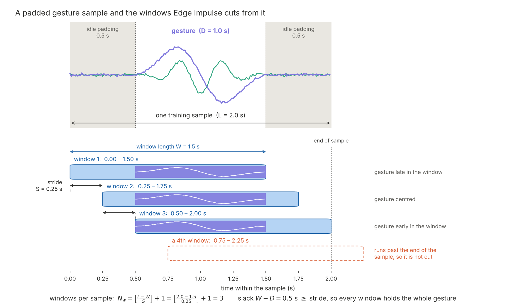

# Assignment 1 — Part 2: Model Development and Deployment

**Due:** October 23 · **Points:** 20

## Goal

Train a gesture classifier on the pooled class dataset, evaluate it on data it has never seen, and deploy it to the Nicla Vision so that it recognizes gestures **continuously** as you perform them.

## Dataset

Download the class dataset: **[link](./dataset/motion_classification_dataset.zip)**

### Where it came from

The dataset was built from your Part 1 submissions: 37 students, 1,849 one-second clips of `doorknob`, `checkmark`, `jab`, `idle`, and `other`. Every clip went through an automated quality check (readable file, 100 samples at 100 Hz, motion present where expected, accelerometer not pinned at its range limit, gesture not cut off at the clip's edge, label among the five assigned). 53 clips were rejected, most of them gestures still in full swing when the one-second recording ended. One student's `check` label was treated as `checkmark`; one student's `wave` class was not used.

The surviving clips were then reshaped for a sliding-window model (see the next section):

- Each gesture clip was padded with 0.5 s of real idle data on each side, so every gesture sample is 2.0 s long with the gesture somewhere in the middle.
- The `idle` and `other` clips were chained into long streams, with smooth transitions at the joins, so these two classes produce about as many windows as each gesture class.
- File names were anonymized and device names removed. Nothing in the dataset identifies who recorded what.

The whole dataset is in the **training** bin. You will create the test split yourself in Edge Impulse.

### What is in it

| Class | Samples | Length per sample | Total | Windows (1.5 s / 0.25 s) |
|-------|--------:|-------------------|------:|-------------------------:|
| `doorknob` | 355 | 2.0 s | 710 s | 1,065 |
| `checkmark` | 354 | 2.0 s | 708 s | 1,062 |
| `jab` | 367 | 2.0 s | 734 s | 1,101 |
| `idle` | 5 | 4 × 60 s + 35 s | 275 s | 1,076 |
| `other` | 5 | 4 × 60 s + 35 s | 275 s | 1,076 |
| **Total** | **1,086** | | **2,702 s** | **5,380** |

### Why 2-second samples, a 1.5-second window, and a 0.25-second stride

On the device, the model does not get to see a neatly cropped gesture. It sees a **window** of the most recent $W$ seconds of sensor data, and that window slides forward by a **stride** of $S$ seconds each time the model runs. Your gesture of duration $D$ lands at a random position inside that window.

- If $W = D$ (a 1-second window for a 1-second gesture), there is no slack: the gesture only fits when the window happens to start exactly when the gesture starts, which almost never happens. Every other window holds a gesture with a piece missing.
- With $W = 1.5$ s and $D \approx 1$ s there is $W - D = 0.5$ s of slack. As long as the stride is no larger than the slack, $S \le W - D$, **at least one window is guaranteed to contain the whole gesture**, wherever it starts. With $S = 0.25$ s, two or three consecutive windows do, which lets you vote across them on the device.

Edge Impulse trains on exactly these windows. From a sample of length $L$ it cuts

$$N_w = \left\lfloor \frac{L - W}{S} \right\rfloor + 1$$

windows, starting at $0, S, 2S, \ldots$ For a 2-second gesture sample: $\lfloor (2.0 - 1.5)/0.25 \rfloor + 1 = 3$ windows, at offsets 0, 0.25 and 0.5 s. Because the padding on each side (0.5 s) equals the slack, **all three contain the complete gesture**, just at different positions. That is the point of the padding: the model learns to recognize the gesture early, centered, and late in the window, which is what it will meet on the device. Padding more than the slack would have produced windows with partial gestures labeled as full ones. The diagram bellow illustrates the window size and stride to capture the gesture completely three times.

For a 60-second idle stream the same formula gives $\lfloor 58.5/0.25 \rfloor + 1 = 235$ windows, which is how the stream lengths were chosen to balance the classes.

## Tasks

In this week's lecture, I will demonstrate the full procedure in Edge Impulse: uploading the dataset, creating the impulse, generating features, training, and testing. Follow along, then do it in your own project.

### 1. Build the impulse

Create a new Edge Impulse project named `mbed-a1p2-<AndrewID>` and upload the dataset (Data acquisition → Upload data → select the `training` folder; the `info.labels` file is picked up automatically).

In **Create impulse**:

| Setting | Value |
|---------|-------|
| Window size | 1500 ms |
| Window increase | 250 ms |
| Frequency | 100 Hz |
| Zero-pad data | **off** |
| Processing block | Spectral Analysis (all six axes) |
| Learning block | Classification |

You may experiment with the processing block's parameters (filter, FFT length, which features to include) and with the network architecture. Record what you tried and what it changed.

### 2. Train and evaluate

1. On the **Dashboard**, use *Perform train / test split* to hold out part of the data for testing before you train.
2. Generate features and look at the feature explorer: are the five classes separable?
3. Train the classifier. Report the validation accuracy and confusion matrix.
4. Run **Model testing** on the held-out test set. Report the test accuracy and confusion matrix. This is the number that matters; validation accuracy during training is optimistic.

### 3. Fit the device

Edge Impulse estimates on-device cost for the Cortex-M7 target (select *Arduino Nicla Vision* as the target in the top bar). Your model must satisfy:

| Constraint | Limit | Why |
|------------|-------|-----|
| Peak RAM | ≤ 100 kB | leaves room for the sketch, the sensor buffers, and the SDK |
| Flash | ≤ 500 kB | the Arduino build gets about 1.4 MB of the internal 2 MB |
| DSP + inference time | ≤ 50 ms | the model runs every 250 ms and must never fall behind the sampler |

A spectral-analysis model for this task is normally far inside these limits. If yours is not, it is a sign that something is oversized.

### 4. Deploy

Export the model as an **Arduino library** (Deployment → Arduino library → Build). You get a ZIP containing the model, the signal-processing code, and example sketches, among them `examples/nicla_vision/nicla_vision_fusion/nicla_vision_fusion.ino`. A copy of that original sketch is in [`code/`](code/) for reference.

#### Editing and uploading the sketch

1. Install the **Arduino IDE 2**.
2. *Tools → Board → Boards Manager*: install **Arduino Mbed OS Nicla Boards**.
3. *Tools → Manage Libraries*: install **Arduino_LSM6DSOX** (the IMU driver) and **VL53L1X** by Pololu (the stock example includes it even though the model does not use it; you may remove that include instead).
4. *Sketch → Include Library → Add .ZIP Library*: select the ZIP you exported from Edge Impulse.
5. *File → Examples → `<your project>_inferencing` → nicla_vision → nicla_vision_fusion*. The IDE opens it read-only; use *File → Save As* to make your own editable copy. The sketch's first `#include` names your library; it must match the library you installed.
6. *Tools → Board → Arduino Mbed OS Nicla Boards → Arduino Nicla Vision*, and *Tools → Port* → the port that mentions Nicla Vision. Leave *Target core* at *Main Core*.
7. *Verify*, then *Upload*. The first build compiles the whole Edge Impulse SDK and takes several minutes; later builds are quick.
8. *Tools → Serial Monitor* at 115200 baud. The stock sketch waits for the monitor to open before it starts.

If an upload fails on the port: double-tap the reset button (the LED fades slowly, the board is in bootloader mode), reselect the port, upload again.

#### Fix the gyroscope scale before you trust any result

The Edge Impulse firmware that collected the Part 1 data did not store the gyroscope in degrees per second, despite the `deg/s` label in the files. It stored **(milli-degrees per second) / 32768**. The Arduino library used by the sketch returns degrees per second. Fed as-is, the model sees gyro values about 29 times larger than anything it was trained on, and its predictions are meaningless.

The fix is one line per axis in `poll_gyr()`: multiply each gyro reading by $70/2000 = 0.035$.

```cpp
uint8_t poll_gyr(void) {
    if (IMU.gyroscopeAvailable()) {
        IMU.readGyroscope(data[3], data[4], data[5]);
        // Convert the library's deg/s into the units the training data used
        data[3] *= (70.0f / 2000.0f);
        data[4] *= (70.0f / 2000.0f);
        data[5] *= (70.0f / 2000.0f);
    }
    return 0;
}
```

(Where the factor comes from: the firmware converted raw sensor counts with 70 mdps per count and then divided by 32768; the Arduino library converts the same counts with 2000/32768 deg/s per count. The ratio is 70/2000.) The accelerometer needs no correction: the stock sketch's clamp at ±2 g already matches the training data.

#### Make it continuous

The stock `nicla_vision_fusion.ino` sketch is not usable for real gesture recognition: it waits two seconds, records a 1.5-second window while doing nothing else, classifies it, prints, and repeats. Any gesture performed during the two-second pause, or straddling the end of a recording, is missed, and there is only one prediction per cycle.

Modify the sketch so that it:

1. samples the IMU **continuously** at 100 Hz into a buffer that always holds the last 1.5 seconds (a ring buffer is the natural structure);
2. runs the classifier on the most recent window **every 0.25 seconds** (every 25 new samples), matching the stride you trained with, without ever pausing the sampling;
3. reports a gesture only when the same label wins with reasonable confidence in **two consecutive windows**, and does not report `idle` or `other` as gestures.

Two hints. Edge Impulse's `run_classifier_continuous()` cannot be used here: the SDK only supports it for audio-style blocks (MFCC, MFE, spectrogram) and prints an error for spectral analysis, so you call the ordinary `run_classifier()` on a window you assemble yourself. And the library's `examples/nano_ble33_sense/nano_ble33_sense_accelerometer_continuous` sketch shows the pattern of sampling in `loop()` while a low-priority RTOS thread runs inference; the Nicla Vision runs the same Mbed OS, so that pattern works here too.

**Where the samples wait: the IMU's own buffer.** The LSM6DSOX does not just hold the latest reading; it has a hardware FIFO of 512 slots, each slot one reading (a 1-byte tag plus 6 bytes for three axes). Recording accelerometer *and* gyroscope uses two slots per time step, so the FIFO holds 256 time steps, about 2.5 s at 100 Hz, before it starts dropping the oldest data (set its mode to *continuous* so that is what happens, rather than stopping when full). You decide when to empty it with the **watermark**: a slot count written to the `FIFO_CTRL1/2` registers; when that many unread slots are waiting, the sensor raises its `FIFO_WTM` flag and, if you wire it, an interrupt pin. The natural setting is **one stride's worth**: 25 time steps × 2 sensors = 50 slots. Then every 0.25 s you read 50 slots (350 bytes) in a single SPI burst, well under a millisecond, append them to your ring buffer, and run the classifier. The sensor's clock sets the spacing of the samples, so timing stays exact however busy the processor is, and the 2.5 s of depth means a late read never loses data. Note that the `Arduino_LSM6DSOX` library does not expose the FIFO; using it means writing those registers yourself (ST's `lsm6dsox_reg` driver has functions for the watermark, batching rate and mode). The simpler alternative, which the stock sketch uses, is to poll `IMU.readAcceleration()` / `IMU.readGyroscope()` every 10 ms on a strict timer and push each reading into the ring buffer yourself. Both are acceptable for this assignment; say in your report which you chose and why.

**Coordinating the two threads.** The sampler (the `loop()` thread, which runs at a higher priority) and the inference thread share one ring buffer, and three rules keep them from corrupting each other's work:

1. *Protect the ring with a mutex*, and hold it for microseconds only: the sampler locks it to write one row (or one FIFO batch) and unlocks; the inference thread locks it to **copy** the latest 150 rows into its own linear buffer and unlocks. The classifier then runs on the copy, never while holding the lock, so the sampler is never blocked for the tens of milliseconds an inference takes.
2. *Let the sampler wake the inference thread*, not the other way round. Every 25 new samples the sampler releases a semaphore; the inference thread blocks on that semaphore and runs once per release. The sampler never waits for anything, so a sample is never late because inference is slow.
3. *Make the semaphore hold at most one pending signal.* If an inference ever overruns the 250 ms stride, the next release is simply dropped rather than queued; when the thread comes back it copies the *newest* window, so it catches up instead of working through stale ones. Count those drops and print the count: it should stay at zero.

In Mbed OS terms these are `rtos::Mutex`, `rtos::Semaphore(0, 1)`, and an `rtos::Thread` started at `osPriorityLow` for inference; the Arduino `loop()` runs at normal priority and pre-empts it.

**You are encouraged to use an agentic AI coding tool** (for example Claude Code, Codex, Copilot agent mode, or similar) to make this modification. Give it the stock sketch, the two hints above, and the gyroscope fix, and review what it produces: you must understand and be able to explain every part of the sketch you submit. Cite the tool and describe what it did in your report, as required by the academic integrity policy.

### 5. Test on the device

With the continuous sketch running and the serial monitor open:

1. Hold the board still: it should report nothing (or `idle`), without false gestures.
2. Perform each gesture 10 times with a short pause between them. Count how many times the correct label was reported, how many times a wrong one was, and how many were missed.
3. Perform a few `other` motions and confirm they do not trigger a gesture.

Record the results as an on-device confusion table (gesture performed × label reported, plus a "missed" column). Expect it to be worse than the Edge Impulse test accuracy; explain why in your report.

## Deliverables

- [ ] Edge Impulse project link (public, or shared with the instructor)
- [ ] Your modified sketch folder, zipped (`<AndrewID>_motion_classification_continuous.zip`)
- [ ] Short report (max 2 pages) containing:
  - impulse settings and anything you changed from the defaults, with its effect
  - test accuracy and confusion matrix from Edge Impulse
  - the on-device confusion table from Task 5, with your explanation of the gap
  - how your sketch achieves continuous inference, in your own words
  - which AI tools you used, for what, and what you changed in their output
- [ ] Demo video (≤ 2 minute without cuts) showing the serial monitor while you perform the three gestures. The video should show successful classification of at least **three** tries in row for each class.  

## Grading rubric

| Criterion | Points |
|-----------|--------|
| Model performance (test accuracy, confusion matrix) | 5 |
| Meets device constraints | 2 |
| Working continuous deployment (gyro fix, sliding window, voting) | 5 |
| On-device evaluation (three successful tries in a row per class) | 5 |
| Report | 3 |
| Total | **20** |
