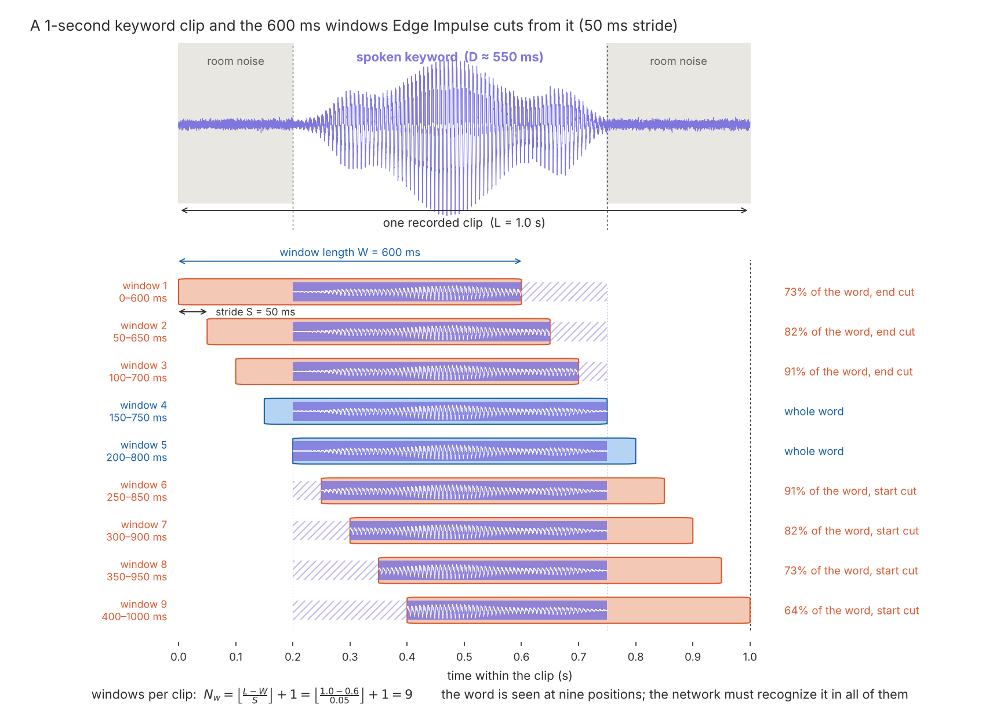

# Assignment 2: Keyword Spotting — Model Development and Deployment

**Due:** Midnight, Friday, Nov. 6th  · **Points:** 40 

## Goal

Train a classifier to recognize the spoken words **red, green, and blue**. Classify other words and noises as either noise or unknown. Evaluate the model on clips it has never heard, then deploy it to the Nicla Vision so it listens continuously and reports a keyword within a fraction of a second.

## Dataset

Download the class dataset: [**link**](https://github.com/z4ziad/mbed-assignments/releases/download/kms-dataset-rgb-v1/speech_command_rgb-export.zip)

### What is in it

The dataset was collected by students like you in a prior offering of the course. They used microphones on their laptop or phones to record the clips.  I then validated the clips and compiled them into a dataset. The noise and unknown classes were created with a script that artificially generated them from the Google Speech Commands dataset.  The script also applied some noise to the other classes.

Every clip is **1.0 second** of mono audio sampled at **16 kHz**. The keyword clips each contain one spoken word, roughly 500–700 ms long, somewhere inside the second, with room noise before and after. The `noise` clips contain background sound without speech, and the `unknown` clips contain speech that is not one of the three keywords.

| Class | Training clips | Test clips | Length per clip | Windows per clip (600 ms / 50 ms) | Training windows |
| --- | --: | --: | --- | --: | --: |
| `red` | 1,200 | 300 | 1.0 s | 9 | 10,800 |
| `green` | 1,200 | 300 | 1.0 s | 9 | 10,800 |
| `blue` | 1,200 | 300 | 1.0 s | 9 | 10,800 |
| `noise` | 1,199 | 300 | 1.0 s | 9 | 10,791 |
| `unknown` | 1,200 | 300 | 1.0 s | 9 | 10,800 |
| **Total** | **5,999** | **1,500** | | | **53,991** |

The dataset is already split 80/20 into training/ and testing/ folders. You can keep this split when you upload it. When you upload the dataset to Edge Impulse, do not move clips between bins or re-split the data. This ensures that every student's test accuracy is measured on the same clips, making the numbers comparable across the class. The test clips are for the final measurement only; everything you tune should be evaluated on the validation set that Edge Impulse carves out of the training bin during training.

### Why a 600 ms window and a 50 ms stride

On the device, the model never sees a neatly trimmed word. It sees a window of the most recent W seconds of audio, and that window slides forward by a stride each time the model runs. The word lands at a random position within the window, and often only part of it is visible. The training windows must look the same, or the model will only work on perfectly aligned clips.

Edge Impulse builds those training windows by splitting each clip of length L into

$$N_w = \left\lfloor \frac{L - W}{S} \right\rfloor + 1$$

windows, starting at offsets 0, *S*, 2*S*, … With *L* = 1.0 s, *W* = 0.6 s and *S* = 0.05 s, every clip yields ⌊0.4 / 0.05⌋ + 1 = 9 windows, each showing the word at a different position:

**Why a 600 ms window?** A spoken "red", "green", or "blue" takes about 400–600 ms in conversation, and a little longer when someone says a single word deliberately into a microphone, as in this dataset. A 600 ms window is long enough to capture the whole word when aligned, and short enough that the word fills the window rather than sitting in a pool of silence. Two further reasons favor a short window: it is cheaper to compute on the device (MFCC cost is proportional to window length), and it is shorter than the clip, which is what makes sliding possible at all. A 1.0 s window on 1.0 s clips gives exactly one window per clip, always with the word at the same place it was recorded; the model would never learn that a word can arrive early or late.

**Why a negative slack is fine here.** Slack is W − D: the window length minus the word duration. It is the extra space left in the window after the word fits. In Assignment 1, we padded the gestures so that W > D and each window held the full gesture. Here, W ≈ D, and for longer utterances in the dataset, W < D. For example, a 700 ms word cannot fit in a 600 ms window. Windows at the ends of the clip may contain only 60–75% of a word, as shown by the orange windows in the figure above.

This is acceptable—and even useful—for speech. Assignment 1’s spectral-analysis features summarized the whole window, so cutting off part of a gesture changed every feature. MFCC features are different: they form a sequence, with one vector per 20 ms frame—30 vectors in a 600 ms window. A convolutional network can learn local patterns in that sequence. Even a window containing 80% of "green" includes nearly all the frames that identify the word. On the device, words slide into and out of the window frame by frame, so the model must recognize words as they arrive or leave. Training on partial words teaches it to do this.

**Why a 50 ms stride?** Each window starts 50 ms after the previous one, or two and a half MFCC frames later, so all nine windows are different examples. A shorter stride (10 or 20 ms) would create nearly identical windows and slow training without adding useful information. A longer stride (200 ms) would give only three windows per clip and three word positions. Nine windows add variety, at the cost of more training time. The stride set in Studio only affects how training windows are cut. On the device, the sketch sets the stride separately by deciding how many slices make up a window.

**Zero-pad data** can stay off: every clip is longer than the window, so no window needs padding.

## Tasks

### 1. Build the impulse

Create a new Edge Impulse project named `mbed-a2-<AndrewID>` and upload the dataset in two steps (Data acquisition → Upload data → *Select a folder*):

1. the `training/` folder, with *Upload into category* set to **Training**;
2. the `testing/` folder, with *Upload into category* set to **Testing**.

Each folder contains an `info.labels` file, so leave the label setting on *Infer from file*; the uploader reads the labels from it. Afterward, the Data acquisition page should show about 80% of the clips under *Training data* and 20% under *Test data*, with all five classes present in both.

In **Create impulse**:

| Setting | Value |
| --- | --- |
| Window size | 600 ms |
| Window increase | 50 ms |
| Frequency | 16000 Hz |
| Zero-pad data | off |
| Processing block | Audio (MFCC) |
| Learning block | Classification |

In the **MFCC** block, start from these parameters, then click **Autotune parameters** and compare:

| Parameter | Start value | What it does |
| --- | --: | --- |
| Number of coefficients | 13 | how many cepstral coefficients are kept per frame (the "columns" of the feature image) |
| Frame length | 0.02 s | audio analysed per frame: 320 samples |
| Frame stride | 0.02 s | step between frames: 30 frames per 600 ms window, 390 features in total |
| Filter number | 32 | mel filters between the low and high frequency |
| FFT length | 512 | must be a power of two and at least the frame length in samples (320), or the frame is truncated |
| Low frequency | 300 Hz | lowest band analysed; Autotune may lower this to about 80 Hz, which is fine |
| Pre-emphasis | 0.98 | boosts high frequencies before analysis |
| Normalization window | 101 | frames over which the mean is removed; cancels microphone gain and distance differences |

You may change these; record what you tried and what it changed in the feature explorer and in the accuracy. Do not change or increase the window size, since the deployment steps assume 600 ms.

In the **Classifier** block, use the default architecture (two 1D convolution/pooling layers with 8 and 16 filters, dropout, and a dense output) as your baseline. Turn on Data augmentation. Keep the defaults for training cycles and learning rate for the first run.

### 2. Train and evaluate

1. Do **not** use *Perform train/test split* on the Dashboard: the test set is the provided `testing/` folder, shared by the whole class. During training, Studio automatically sets aside a validation portion of the training bin (20% by default); that is the set you use to compare your experiments.
2. Generate features and look at the feature explorer: are the five classes separable? Which pairs overlap?
3. Train the classifier. Report the training accuracy, the validation accuracy and the validation confusion matrix. Note whether training accuracy is above or below validation accuracy and what that tells you (see Extra credit A).
4. When you are done experimenting, run **Model testing** on the test set. Report the test accuracy and confusion matrix, per class. This is the number that matters; validation accuracy during training is optimistic, and the test clips were never seen in training.

### 3. Fit the device

Edge Impulse estimates on-device cost for the Cortex-M7 target (select *Arduino Nicla Vision* as the target in the top bar). Your model must satisfy:

| Constraint | Limit | Why |
| --- | --- | --- |
| Peak RAM | ≤ 200 kB | Leaves room for the sketch, the audio buffers, and the SDK |
| Flash | ≤ 500 kB | The Arduino build gets about 1.4 MB of the internal 2 MB |
| DSP + inference time | ≤ 100 ms | The deployed sketch classifies every 200 ms and must never fall behind the microphone |

Report the estimates for your final model. The baseline model is about 12 kB and runs in well under a millisecond; it is far inside these limits, which is a hint for Extra credit A.

### 4. Deploy

Export the model as an **Arduino library** (Deployment → Arduino library → keep the *Quantized (int8)* option → Build). You get a ZIP containing the model, the signal-processing code, and example sketches, among them `examples/nicla_vision/nicla_vision_microphone_continuous/nicla_vision_microphone_continuous.ino`. A copy of that original sketch is in [`code/`](code/) for reference.

Unlike the motion example of Assignment 1, Edge Impulse produces a continuous sketch for a microphone for the Nicla Vision: the microphone runs all the time, the audio is cut into **slices**, and the Edge Impulse SDK function `run_classifier_continuous()` computes MFCC features for each new slice and classifies the most recent window every time a slice arrives. The number of slices per window is the `EI_CLASSIFIER_SLICES_PER_MODEL_WINDOW` macro, which Edge Impulse sets to 4: a 600 ms window gives 150 ms slices, and one classification every 150 ms. The macro is guarded by `#ifndef`, so you can override it by adding a `#define` *before* the library's `#include` in the sketch; 3 (a classification every 200 ms, a whole number of 20 ms frames) is a good value for this window.

#### Editing and uploading the sketch

1. Install the **Arduino IDE 2**.
2. *Tools → Board → Boards Manager*: install **Arduino Mbed OS Nicla Boards**. The microphone driver (`PDM`) is part of that package; no other library is needed.
3. *Sketch → Include Library → Add .ZIP Library*: select the ZIP you exported from Edge Impulse. If you later export a new version of the model, delete the old library folder from `~/Documents/Arduino/libraries/` first, then add the new ZIP.
4. *File → Examples → `<your project>_inferencing` → nicla_vision → nicla_vision_microphone_continuous*. The IDE opens it read-only; use *File → Save As* to make your own editable copy. The sketch's first `#include` names your library; it must match the library you installed.
5. *Tools → Board → Arduino Mbed OS Nicla Boards → Arduino Nicla Vision*, and *Tools → Port* → the port that mentions Nicla Vision. Leave *Target core* at *Main Core* and *Flash split* at its default.
6. *Verify*, then *Upload*. The first build compiles the whole Edge Impulse SDK and takes several minutes; later builds are quick.
7. *Tools → Serial Monitor* at 115200 baud. The stock sketch waits for the monitor to open before it starts, then prints all five class scores once per window.

If an upload fails on the port: double-tap the reset button (the LED fades slowly; the board is in bootloader mode), reselect the port, and upload again.

### 5. Test on the device

With the sketch running and the serial monitor open, from about 30 cm:

1. Stay quiet for ten seconds: `noise` should dominate, and no keyword should score above 0.6.
2. Say each keyword 10 times with a two-second pause between repetitions. For each repetition, note which class had the highest score (treat a highest score below 0.6 as "nothing detected").
3. Say ten other words ("yellow", "hello", your name, …) and check that no keyword wins.

Record the results as an on-device confusion table (word spoken × class reported, plus a "nothing detected" column). Expect it to be worse than the Edge Impulse test accuracy; explain why in your report (speaker, distance and room differ from the recordings, the word is not centered in the window, the stock sketch's audio handling, …).

## Improvements

Do the required tasks above first.

### A. A larger classifier with test accuracy above 90%

The baseline network has about 1,400 trainable parameters. If your training accuracy came out *at or below* your validation accuracy (typically both around 85%), the model is **underfitting**: it is too small even to memorize its own training data, and no amount of extra data will help. (Training accuracy is measured with dropout and augmentation active, so a model that fits well shows training accuracy a few points *above* validation.)

Grow the network until the **test accuracy** (Task 2, step 4) exceeds **90%** while staying inside the device limits of Task 3. Reasonable moves, in order:

- more filters in the two convolution layers (16 and 32 instead of 8 and 16);
- a third 1D conv/pool layer (64 filters); do not add a fourth, since each pooling halves the 30-frame time axis and four would leave only two steps;
- a dense layer of 32–64 neurons with dropout after the flatten layer;
- a lower learning rate (0.001) with more training cycles, until the validation loss levels off.

Watch for the opposite failure as you grow: when training accuracy climbs more than about ten points above validation, the model has started to memorize, and the remedy is more dropout or a smaller dense layer, not more convolution filters.

Tune using the **validation** numbers only. Run Model testing on the shared test set once at the end; a test set used to choose the architecture no longer measures anything, and because every student tests on the same clips, the 90% threshold means the same thing for everyone. In your report, include the architecture, parameter count, quantized model size and latency from Studio, and training, validation, and test accuracy for both the baseline and the final model.

### B. An improved deployment sketch

The example sketch works, but it was written for demonstrations, not for use. Improve it so that:

1. **Only keywords are reported.** The sketch prints a single line with the word and its score when `red`, `green`, or `blue` scores are at or above a threshold, and prints nothing for `noise` or `unknown`. The thresholds are three separate `#define`s, one per keyword, so each can be tuned on its own. A word that stays in the window for several consecutive classifications is reported once, not once per slice (a hold-off time after each report is the simplest way).
2. **No audio is lost.** Differences from Assignment 1 for motion classification:

   The pipeline is the same: sensor → buffer → DSP → classifier. The difference is who fills and empties the buffer.

   In Assignment 1, the sketch fills the buffer. `loop()` reads the IMU every 10 ms, while a second, low-priority thread runs the classifier. Because the threads may need to wait for each other, a mutex protects the ring buffer, and a semaphore signals when data is ready.

   In Assignment 2, the hardware fills the buffer. The microphone's DMA sends 1,024 samples at a time and calls the sketch's callback from an interrupt. Interrupt code must not wait. If it tried to lock a mutex held by `loop()`, it could stall and cause Mbed to fault. So the interrupt produces data, and `loop()` consumes it. They use a non-waiting handshake: each side updates its own index, the indices are `volatile`, and a barrier is used before publishing data.

   There are two other differences. In Assignment 1, the classifier needs the full 1.5-second window each time, so it recalculates features over all the data and copies 150 rows while holding the lock. In Assignment 2, `run_classifier_continuous` needs only the latest 200 ms of data. The SDK keeps earlier features, so the ring buffer needs only a few slices and no copy is required.

   Finally, audio arrives in 64 ms chunks, which do not line up evenly with the slices. This is where the stock example loses samples.

   Read the microphone callback `pdm_data_ready_inference_callback()` carefully. The PDM driver delivers audio in chunks of 1,024 samples (64 ms); what happens to the rest of a chunk when `buf_count` reaches `n_samples` in the middle of it? You can work out how much audio is discarded per slice with a 600 ms window, then redesign the buffering so that every sample reaches the classifier. The natural design is a ring buffer that the callback writes into and `loop()` reads one slice at a time. Note that the callback runs in **interrupt context**: it must never block, so the mutex-and-semaphore scheme from Assignment 1 does not apply. A ring with one writer and one reader can be made safe without a lock if each side owns its own index, the indices are `volatile`, and a memory barrier (`__DMB()`) separates writing the samples from publishing the new index. Count the samples you do drop (when the loop falls behind) and print the counter periodically; it should read zero.
3. **The stride is explicit.** Set `EI_CLASSIFIER_SLICES_PER_MODEL_WINDOW` from the sketch (see Task 4) and print the window, slice, and ring sizes at start-up so the serial log documents the configuration.

Then repeat Task 5 with your sketch and report both confusion tables.

#### Using an agentic AI coding tool for this task

You are encouraged, and for this task expected, to use an agentic AI coding tool (Claude Code, Codex, Copilot agent mode, or similar). Used well, it will do most of the typing; used badly, it will produce confident code that drops audio in a new way. These guidelines are what "used well" means here:

1. **Give it the right context, not the whole library.** Provide the stock sketch, the library's `src/model-parameters/model_metadata.h` (the macros for window size, slice size, sample rate, and labels live there), and the facts about the platform that the tool cannot infer: the PDM callback runs in interrupt context and delivers 1,024 samples per call; `run_classifier_continuous()` must receive exactly `EI_CLASSIFIER_SLICE_SIZE` samples per call, in order, with no gaps; the board runs Mbed OS on a Cortex-M7.
2. **Ask it to explain before it changes anything.** Have it describe the data flow of the stock sketch from the interrupt to the classifier, and check that description against the code yourself. Then ask it to find the flaw in the callback. If it cannot find the discarded samples even after you point at the `break`, do not trust its rewrite either.
3. **Specify behavior, not code.** Give it the three requirements above as a checklist, plus the rules the design must respect (nothing blocking in the interrupt, `volatile` shared indices, barrier before publishing, the reader never touches a region the writer may be filling, the ring must hold at least one slice plus one chunk). Let it propose the design; you judge it.
4. **Make it prove it.** Ask for a small host-side test program that feeds the ring from a simulated interrupt with a counting sequence and checks that every slice handed to the classifier is contiguous, including when the consumer stalls. Compile the real sketch yourself in the Arduino IDE, since the tool usually cannot, and run it on the board: the drop counter and the keyword lines are your acceptance test.
5. **Review every line, and own it.** You must be able to explain, in the demo or in the report, what `volatile` does here, why a mutex is not used, why `__DMB()` is needed, how the ring detects overflow, and what happens when the loop falls behind. "The AI wrote that part" is not an answer.
6. **Know the common failures.** Tools often invent SDK functions or parameters (for example, the moving-average argument of `run_classifier_continuous()` is deprecated in current SDK versions and does nothing), declare success without compiling, use `delay()` as a synchronization mechanism, or change `model_metadata.h` inside the library instead of the sketch. Check for each of them.
7. **Keep a log.** Record the prompts you used, what the tool got wrong, and what you changed. That log goes in your report; it is required by the academic integrity policy, and it is also the most instructive part of the exercise.

## Deliverables

- [ ] Edge Impulse project link (public, or shared with the instructor)
- [ ] Your sketch folder, zipped (`<AndrewID>_nicla_vision_microphone_continuous.zip`); the stock sketch with the include matching your library is acceptable for the required part; the improved sketch for Extra credit B
- [ ] Short report (max two pages) containing:
  - impulse and MFCC settings, anything you changed from the defaults, and its effect
  - training, validation, and test accuracy and the test confusion matrix from Edge Impulse
  - device cost estimates (RAM, flash, latency) for your model
  - the on-device confusion table from Task 5, with your explanation of the gap
  - The baseline and final architectures with the numbers listed in that section
  - How your sketch buffers audio and why it is safe, your AI-tool log, and the second on-device table
  - Short answer to this conceptual question: When testing deployment on the device, try words that sound similar to red, green, and blue. For example, the word bread, which contains the red sound, or perhaps the word seen, which sounds like green. Did your model misclassify these similar-sounding words? If so, how would you fix this problem while still consuming very little power? Hint: "Hi Siri" or "Ok, Google."
- [ ] Demo video (≤ 1 minute) showing the serial monitor while you say the three keywords and a few other words

## Grading rubric

| Criterion | Points |
| --- | --: |
| Impulse and MFCC design, with the reasoning recorded | 10 |
| Model performance (test accuracy, per-class confusion matrix) | 5 |
| Meets device constraints | 5 |
| Working deployment and on-device evaluation | 5 |
| Report | 5 |
| Answer to conceptual question | 2 |
| Design of larger classifier with test accuracy above 90% | 3 |
| Improved sketch (keyword-only output with per-class thresholds, lossless buffering, explicit stride) and AI-tool log | 3 |
| Add a separate control loop on the M4 core to flash the LED twice per color. | 2 |
| **Total** | **40** |
