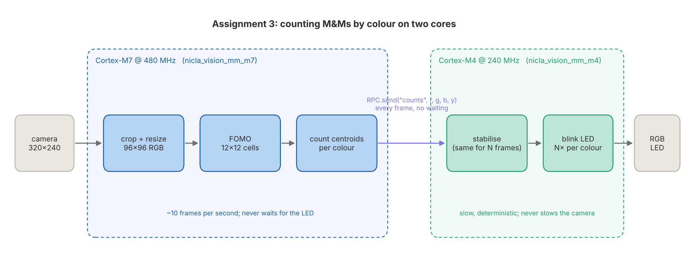

# Assignment 3: Counting M&Ms by Color — Data, Model and Deployment

**Due:** Wednesday, Nov 25 at midnight · **Points:** 40
## Goal

Build an object detector that finds every M&M on a tray and tells its color, run it on the Nicla Vision’s M7 core at several frames per second, and have the M4 core show the count of each color on the RGB LED.

## Why M&Ms, and why FOMO

FOMO (Faster Objects, More Objects) is Edge Impulse's object-detection architecture for microcontrollers. It keeps the YOLO model backbone but removes the bounding-box heads. Instead, it uses receptive fields to compute object centers. It divides the 96 × 96 input image into a 12 × 12 grid of 8-pixel cells and, for each cell, says which class is centered there, if any. The output is a set of **centroids**, one per detected object, which is exactly what counting needs. Because there are no bounding box detection heads, the model is small (about 100 kB) and fast (about 10 frames per second on the M7), because it never has to decide how big an object is.

That design brings three assumptions, and M&Ms satisfy all of them:

1. **Objects are about the same size.** Every M&M is 13 mm across; at 25–30 cm it covers 8–10 pixels of the 96 × 96 input, about one grid cell.
2. **Objects do not overlap or touch.** Two touching candies land in one cell and FOMO reports one centroid. Your dataset and your demo must keep candies at least one candy-width apart.
3. **Classes differ in colour or texture, not in fine shape.** At 96 × 96, a candy is a coloured blob; color is the only thing left to tell them apart, and that is what we want.

The hard part is not the model; it is color under real lighting. Under warm indoor light, orange drifts toward red and brown toward black, and the Nicla camera doesn’t apply the color correction your phone does. The basic part uses the four colors that stay apart (red, green, blue, yellow); the hard ones (orange & brown) add two additional points.

## Tasks

### 1. Collect images

Set up a fixed station: the Nicla Vision mounted 25–30 cm above a tray, camera pointing straight down. Keep this geometry for every image and for the live demo, since FOMO assumes a constant object scale.

Create an Edge Impulse project named `mbed-a3-<AndrewID>` and connect the board (Devices → *Connect a new device* → Nicla Vision, using the Edge Impulse firmware flashed with the instructions on the Nicla Vision page in the Edge Impulse docs). Collect with **Data acquisition → Camera**, 320 × 240, not with your phone: the phone's colors are corrected for white balance, and a model trained on phone images would mislabel colors on the Nicla.

Collect **at least 120 images**, each with **8 to 20 candies**, spread so that no two touch. Vary, deliberately and in roughly equal shares:

| Vary | Values | Why |
|---|---|---|
| Lighting | daylight, warm lamp, cool/fluorescent | colour shifts are the main failure |
| Background | white paper, dark tray, patterned surface | the model must find candies, not "white dots on white" |
| Mix | some images with one color missing, some dominated by one color | so no class is learned from its frequency |
| Position | candies near edges and corners as well as centred | FOMO's edge cells see less context |

Keep 20 extra images, under lighting you did not use for the others, in a separate folder; they become your test set in Task 3.

### 2. Label

In Edge Impulse, **Data acquisition → Labeling queue**. Draw a box around every candy and give it its color; for the basic part, label orange and brown candies as `other` (or leave them out of the tray). The box size does not matter to FOMO, only its center, so draw quickly but center well. Turn on *Track objects between frames*: after the first image of a session, the tool proposes boxes, and you only correct them. Budget about an hour for 120 images.

Two rules the model will enforce if you don't: label **every** candy in every image (an unlabelled candy becomes a "background" example of a candy, which poisons the class), and keep the class names identical across all images (`red`, not `Red` in some).

### 3. Build the impulse and train

Upload the 20 held-out images into the **Testing** bin. In **Create impulse**:

| Setting | Value |
|---|---|
| Image width × height | 96 × 96 |
| Resize mode | Fit shortest axis |
| Processing block | Image |
| Learning block | Object Detection (Images) |

Image block: color depth **RGB** (grayscale throws away the only feature we have). Generate features.

Object detection block: choose **FOMO (Faster Objects, More Objects) MobileNetV2 0.35**, learning rate 0.001, 60 training cycles, data augmentation on. Train, then read the result:

- Edge Impulse reports **precision, recall, and F1 per class**, computed on grid cells, plus a confusion matrix whose extra row and column are "background". A candy counted as background is a miss (recall); background counted as a candy is a false alarm (precision).
- Report per-class F1 on the validation set and on your test set (Model testing). The target for the required part is **F1 ≥ 0.85 for each of the four colors** on the test set.
- Look at the test images in Model testing with the predicted centroids overlaid. Which candies are missed? Which colors get swapped? Under which lighting? Write it down; it goes in the report.

If a class is weak, the fix is almost always data: more images under the lighting where it fails, or more candies of that color. Only after that try the 0.1-alpha variant (smaller, faster, less accurate) or a longer training run.

### 4. Fit the device

Edge Impulse estimates on-device cost for the Cortex-M7 (select *Arduino Nicla Vision* as the target). Your model must satisfy:

| Constraint | Limit | Why |
|---|---|---|
| Peak RAM | ≤ 250 kB | the camera frame buffer (320 × 240 × 2 bytes = 150 kB) and the sketch need the rest of the M7's 512 kB |
| Flash | ≤ 500 kB | |
| Inference time | ≤ 150 ms | at least 5 frames per second, measured on the board, not estimated |

### 5. Deploy to the M7

Export as an **Arduino library** (Quantized int8). The library's example `nicla_vision_camera` captures a frame, resizes it to 96 × 96, runs the model, and prints each detected object as `label (value) [x, y, width, height]`; for FOMO, the width and height are the grid cell, and `x, y` is the centroid. Build it as in Assignment 2 (Flash split `1.5MB M7 + 0.5MB M4`, Target core *Main Core*), run it, and check that printed centroids match what is on the tray.

Then modify it:

1. Count the detections per class in each frame (a detection counts only if its value is at or above a per-class threshold; three or four `#define`s, as in the keyword sketch).
2. Print one line per frame: the frame number, the time the frame took, and the four counts.
3. Send the counts to the M4 every frame with `RPC.send("counts", red, green, blue, yellow)` (Task 6). `RPC.send` does not wait for the M4, so the frame rate does not depend on what the M4 is doing.

Measure your real frame rate from the printed frame times over at least 100 frames. It will be lower than Studio's inference estimate because capture and resize take time too; report both numbers.

### 6. Show the counts on the M4

Start from the dual-core keyword solution from Assignment 2 (the M4 sketch there binds one RPC function and plays an LED pattern; the mechanism is identical). Write an M4 sketch that:

1. Binds `counts` and stores the latest four counts. The RPC callback runs in the RPC library's thread: store and return; do the display in `loop()`.
2. Decides when the scene is **stable**: the counts have been identical for `STABLE_FRAMES` consecutive frames (start with 5) and differ from the counts last displayed. Without this rule, the LED would start a new sequence on every frame and never finish one.
3. Displays the stable counts: for each color with a count above zero, in a fixed order (red, green, blue, yellow), blink the LED in that color `count` times (150 ms on, 150 ms off), then pause 600 ms before the next color, then turn the LED off. A count of zero is skipped. Four reds, two blues reads as: red red red red, pause, blue blue, off.
4. Prints what it displays; the M7 forwards the M4's output to the serial monitor.

Remember from Assignment 2 that the LED pins have no PWM and the LED is active-low. You do not need dimming here, only on/off.

The same rules for working with an agentic AI coding tool apply as in Assignment 2: give it the two sketches from the keyword solution and the stock camera example as context, ask it to explain the data flow before changing anything, specify the behavior as a checklist, compile and test on the board yourself, and keep a log of prompts and corrections for the report.

### 7. Live counting test

With the station very well lit as in your data and the serial monitor open, place these trays and record, for each, the counts the M4 displays and the counts printed by the M7 over 10 consecutive frames:

| Tray | Contents |
|---|---|
| A | empty |
| B | 1 red, 1 green, 1 blue, 1 yellow, well spaced |
| C | 4 red, 2 blue |
| D | 3 of each of the four colors, spaced |
| E | tray D with two candies touching |
| F | tray D under a lighting you did not collect with |

Report a table of true count vs reported count per color per tray, and explain the misses. Trays E and F are supposed to fail in specific ways; say which way and why.

## Now the hard colors

### A. Orange and brown

Add `orange` and `brown` as classes (relabel the `other` candies, add images where they are frequent), retrain, and report per-class F1 for all six on the test set. Expect the red/orange and brown/black-background confusions; the report should show which lighting makes them worse, and what you did about it (more data under that lighting, a different background, a white-balance trick in the capture code, …). Threshold: F1 ≥ 0.75 for orange and brown on the test set, with the four required colors still ≥ 0.85.

### B. Stable counting over time

Per-frame counts flicker: a candy at the edge of a cell is detected in one frame and not the next. Instead of requiring identical counts for `STABLE_FRAMES` frames, keep a short history on the M4 (the last 10–15 frames) and display the **median** count per color whenever it changes. Report how long the display takes to settle after the tray changes, and how often it shows a wrong count, compared with the simple rule from Task 6. This is the kind of temporal filtering that belongs on the control core: it runs at a fixed rate whatever the M7's frame timing does.

## Deliverables

- [ ] Edge Impulse project link (public, or shared with the instructor)
- [ ] Both sketch folders, zipped (`<AndrewID>_mm_counting.zip`: the M7 sketch and the M4 sketch)
- [ ] Short report (2 pages max) containing:
  - how you collected and labeled the data (station, lighting, backgrounds, counts of images and of candies per color)
  - impulse and training settings; per-class precision, recall and F1 on validation and test, and the test confusion matrix
  - device cost estimates and the measured frame rate
  - the live counting table from Task 7 with the explanation of the misses
  - how the M4 decides when to display, and your AI-tool log
  - with two hard colors: the six-class results and what you did about the confusions
  - settling time and error rate of the two rules
- [ ] Demo video (≤ 1 minute): tray C and tray D, showing the serial monitor and the LED

## Grading rubric

| Criterion | Points |
|---|---|
| Dataset: variety, complete and consistent labels, held-out test set | 10 |
| Model performance (F1 ≥ 0.85 per required color on the test set) | 10 |
| Meets device constraints; frame rate measured | 5 |
| M7 sketch: per-class counting with thresholds, per-frame output, counts sent over RPC | 2 |
| M4 sketch: stability rule and LED display as specified | 3 |
| Live counting test and explanation | 3 |
| Report and AI-tool log | 2 |
| Extra credit A: orange and brown | 2 |
| Extra credit B: median filter on the M4 | 3 |
| **Total**   | **40**  |
